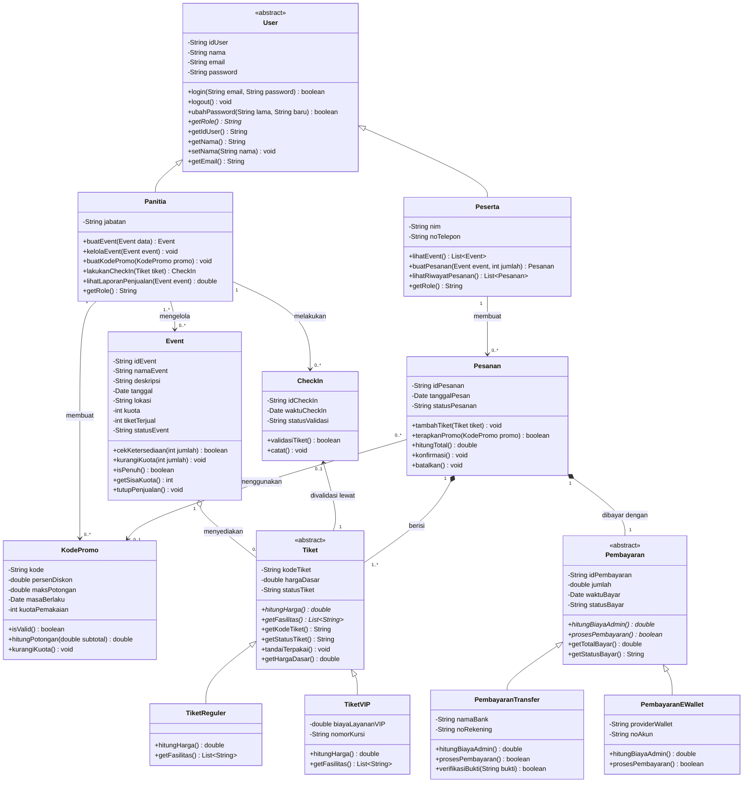

# Spesifikasi Arsitektur dan Kontrak Teknis: EventTix

Dokumen ini merupakan referensi teknis utama (Single Source of Truth) untuk asisten AI (AI Coding Agents / LLMs) dan pengembang yang mengerjakan proyek **EventTix**. Seluruh implementasi kode pada modul Java Console dan Web PHP wajib mematuhi spesifikasi nama kelas, atribut, tanda tangan metode (method signatures), dan relasi di bawah ini secara ketat agar proses integrasi antar-cabang (branch) berjalan tanpa konflik.

---

## 1. Aturan Implementasi Ketat (Strict Rules for AI Agents)

1. **Konsistensi Penamaan (Exact Naming):** Gunakan nama kelas, atribut, dan metode persis seperti yang tertulis pada spesifikasi di bawah (dalam Bahasa Indonesia, *camelCase* untuk atribut/metode, *PascalCase* untuk kelas). Dilarang menerjemahkan nama *identifier* ke dalam Bahasa Inggris.
2. **Deklarasi Package (Java):** Seluruh file `.java` berada di dalam direktori `java-console/src/eventtix/` dan **wajib** memiliki deklarasi `package eventtix;` pada baris pertama.
3. **Impor Standar (Java):** Gunakan pustaka standar Java (`java.util.Date`, `java.util.List`, `java.util.ArrayList`). Tidak diperbolehkan menggunakan pustaka eksternal (Maven/Gradle).
4. **Enkapsulasi:** Seluruh atribut bersifat `private` (`-`) dan diakses/dimodifikasi melalui *getter/setter* atau metode publik (`+`) yang telah ditentukan.
5. **Kompatibilitas Antar-Modul:** Jangan mengubah tipe parameter atau tipe kembalian (*return type*) dari metode publik karena kelas lain bergantung pada kontrak antarmuka tersebut.

---

## 2. Diagram Kelas (Mermaid.js Reference)

---

## 3. Spesifikasi Detail Kelas & Kontrak Metode (Java)

### Modul 1: Pengguna & Event (`branch: user-event`)

1. **`User` (Abstract Class)**
* **Atribut:** `private String idUser`, `private String nama`, `private String email`, `private String password`.
* **Metode Abstrak:** `public abstract String getRole()`.
* **Metode Konkret:** `login(String email, String password): boolean`, `logout(): void`, `ubahPassword(String lama, String baru): boolean`, `getIdUser(): String`, `getNama(): String`, `setNama(String nama): void`, `getEmail(): String`.

2. **`Panitia` (Extends `User`)**
* **Atribut:** `private String jabatan`.
* **Metode:** `buatEvent(Event data): Event`, `kelolaEvent(Event event): void`, `buatKodePromo(KodePromo promo): void`, `lakukanCheckIn(Tiket tiket): CheckIn`, `lihatLaporanPenjualan(Event event): double`, `getRole(): String` (mengembalikan `"Panitia"`).

3. **`Peserta` (Extends `User`)**
* **Atribut:** `private String nim`, `private String noTelepon`, serta koleksi internal `List<Pesanan> riwayatPesanan`.
* **Metode:** `lihatEvent(): List<Event>`, `buatPesanan(Event event, int jumlah): Pesanan`, `lihatRiwayatPesanan(): List<Pesanan>`, `getRole(): String` (mengembalikan `"Peserta"`).

4. **`Event`**
* **Atribut:** `private String idEvent`, `private String namaEvent`, `private String deskripsi`, `private Date tanggal`, `private String lokasi`, `private int kuota`, `private int tiketTerjual`, `private String statusEvent`, serta referensi `List<Tiket> daftarTiket`.
* **Metode:** `cekKetersediaan(int jumlah): boolean`, `kurangiKuota(int jumlah): void`, `isPenuh(): boolean`, `getSisaKuota(): int` (mengembalikan `kuota - tiketTerjual`), `tutupPenjualan(): void`.

### Modul 2: Tiket & Check-In (`branch: tiket-checkin`)

5. **`Tiket` (Abstract Class)**
* **Atribut:** `private String kodeTiket`, `private double hargaDasar`, `private String statusTiket` (contoh nilai: `"Tersedia"`, `"Terjual"`, `"Terpakai"`).
* **Metode Abstrak:** `public abstract double hitungHarga()`, `public abstract List<String> getFasilitas()`.
* **Metode Konkret:** `getKodeTiket(): String`, `getStatusTiket(): String`, `tandaiTerpakai(): void` (mengubah `statusTiket` menjadi `"Terpakai"`), `getHargaDasar(): double`.

6. **`TiketReguler` (Extends `Tiket`)**
* **Atribut:** Tidak memiliki atribut tambahan.
* **Metode:** `hitungHarga(): double` (mengembalikan `getHargaDasar()`), `getFasilitas(): List<String>`.

7. **`TiketVIP` (Extends `Tiket`)**
* **Atribut:** `private double biayaLayananVIP`, `private String nomorKursi`.
* **Metode:** `hitungHarga(): double` (mengembalikan `getHargaDasar() + biayaLayananVIP`), `getFasilitas(): List<String>`.

8. **`CheckIn`**
* **Atribut:** `private String idCheckIn`, `private Date waktuCheckIn`, `private String statusValidasi`, serta referensi `private Tiket tiket`.
* **Metode:** `validasiTiket(): boolean` (memeriksa apakah status tiket valid dan belum terpakai, lalu memanggil `tiket.tandaiTerpakai()`), `catat(): void`.

### Modul 3: Pesanan & Promo (`branch: pesanan-promo`)

9. **`KodePromo`**
* **Atribut:** `private String kode`, `private double persenDiskon`, `private double maksPotongan`, `private Date masaBerlaku`, `private int kuotaPemakaian`.
* **Metode:** `isValid(): boolean` (mengecek masa berlaku terhadap waktu saat ini dan `kuotaPemakaian > 0`), `hitungPotongan(double subtotal): double` (menghitung `subtotal * persenDiskon`, dibatasi maksimal sebesar `maksPotongan`), `kurangiKuota(): void`.

10. **`Pesanan`**
* **Atribut:** `private String idPesanan`, `private Date tanggalPesan`, `private String statusPesanan` (contoh: `"Pending"`, `"Lunas"`, `"Dibatalkan"`).
* **Atribut Relasi (Wajib Ada):** `private List<Tiket> daftarTiket` (Composition `1..*`), `private KodePromo promo` (Association `0..1`, bernilai `null` jika tidak menggunakan promo), `private Pembayaran pembayaran` (Composition `1`).
* **Metode:** `tambahTiket(Tiket tiket): void`, `terapkanPromo(KodePromo promo): boolean` (memvalidasi promo lalu menyimpannya), `hitungTotal(): double` (menjumlahkan `hitungHarga()` dari seluruh tiket di `daftarTiket` dikurangi potongan `KodePromo` jika ada), `konfirmasi(): void`, `batalkan(): void`.

### Modul 4: Pembayaran (`branch: pembayaran`)

11. **`Pembayaran` (Abstract Class)**
* **Atribut:** `private String idPembayaran`, `private double jumlah`, `private Date waktuBayar`, `private String statusBayar`.
* **Metode Abstrak:** `public abstract double hitungBiayaAdmin()`, `public abstract boolean prosesPembayaran()`.
* **Metode Konkret:** `getTotalBayar(): double` (mengembalikan `jumlah + hitungBiayaAdmin()`), `getStatusBayar(): String`.

12. **`PembayaranTransfer` (Extends `Pembayaran`)**
* **Atribut:** `private String namaBank`, `private String noRekening`.
* **Metode:** `hitungBiayaAdmin(): double`, `prosesPembayaran(): boolean`, `verifikasiBukti(String bukti): boolean`.

13. **`PembayaranEWallet` (Extends `Pembayaran`)**
* **Atribut:** `private String providerWallet`, `private String noAkun`.
* **Metode:** `hitungBiayaAdmin(): double`, `prosesPembayaran(): boolean`.

---

## 4. Pedoman Arsitektur Web PHP & MySQL (`branch: web-php`)

Untuk menjaga konsistensi antara prototipe OOP Java dan aplikasi Web PHP Native:

1. **Skema Database (`web-php/database/eventtix.sql`):**
* Gunakan pendekatan *Single Table Inheritance* atau *Class Table Inheritance* untuk memetakan hierarki kelas abstrak:
* Tabel `users` (memiliki kolom `role` ENUM `'panitia'`, `'peserta'`, ditambah kolom `jabatan`, `nim`, `no_telepon` yang bersifat *nullable*).
* Tabel `events`
* Tabel `tiket` (memiliki kolom `jenis_tiket` ENUM `'reguler'`, `'vip'`, `biaya_layanan_vip`, `nomor_kursi`, dan *foreign key* `id_event` serta `id_pesanan`).
* Tabel `kode_promo`
* Tabel `pesanan` (memiliki *foreign key* `id_user` dan `kode_promo` *nullable*).
* Tabel `pembayaran` (memiliki *foreign key* `id_pesanan`, kolom `metode` ENUM `'transfer'`, `'ewallet'`, serta atribut spesifik masing-masing metode).
* Tabel `checkin` (memiliki *foreign key* `kode_tiket` dan `id_panitia`).

2. **Struktur Direktori Web:**
* Koneksi PDO/MySQLi diletakkan secara terpusat pada `web-php/config/database.php`.
* Alur utama yang wajib diprioritaskan: Login/Register -> Katalog Event -> Pemesanan Tiket + Promo -> Checkout Pembayaran -> Validasi Check-In Panitia.

---
