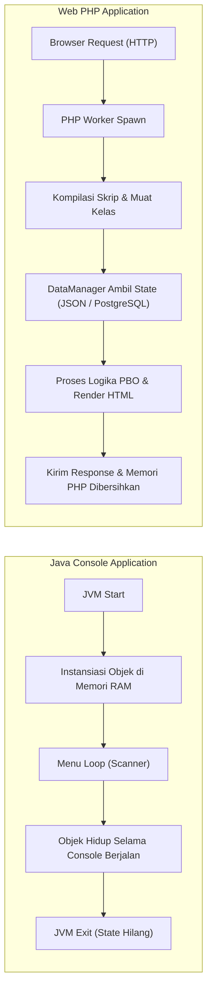
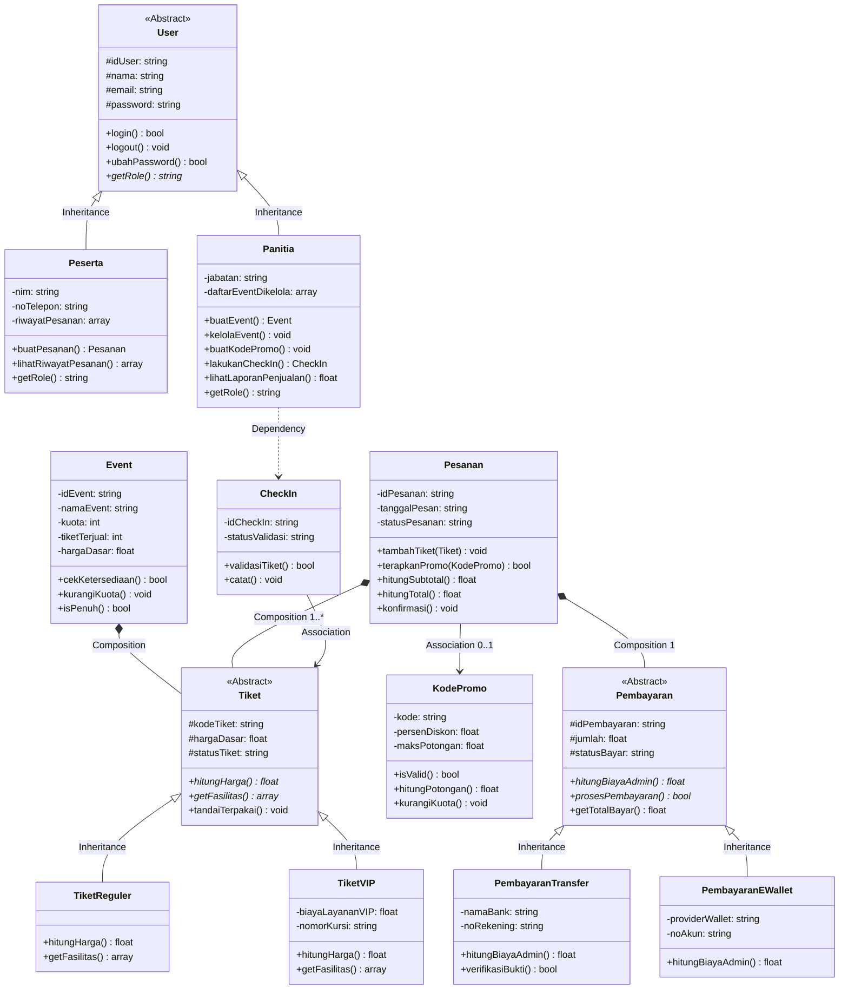
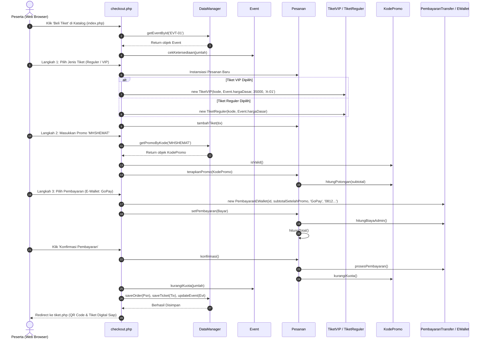

# Panduan Arsitektur & Penerapan PBO: EventTix (Java Console ke Web PHP)

Dokumen ini disusun sebagai referensi belajar dan penguasaan materi untuk **Tugas Besar Pemrograman Berbasis Objek (PBO) - Semester 5**. Panduan ini membedah bagaimana rancangan sistem yang ada pada **Java Console** diimplementasikan ke dalam **Web PHP Native**, prinsip-prinsip desain yang diterapkan, fungsi setiap file, hingga integrasi kode pada antarmuka web.

---

## 1. Perbedaan Paradigma: Java Console vs Web PHP

Sebelum membedah baris kode, pahami perbedaan mendasar bagaimana sistem berjalan di kedua bahasa:



| Aspek | Java Console (`java-console/`) | Web PHP (`web-php/` & `web/`) |
| :--- | :--- | :--- |
| **Siklus Hidup (*Lifecycle*)** | *Stateful* (program berjalan terus di JVM). | *Stateless Request-Response* (setiap kali halaman di-refresh, skrip PHP dieksekusi dari awal lalu memorinya dibersihkan). |
| **Persistensi Data** | Di memori RAM (`ArrayList<Event>`, `List<Tiket>`). | Ditangani oleh kelas `DataManager` yang menjembatani objek PHP ke file `data/store.json` atau database SQL. |
| **Penulisan Konstruktor** | Bernama sama dengan nama kelas: `public Event(...)` | Menggunakan keyword standar PHP: `public function __construct(...)` |
| **Tipe Data & Type Hinting** | Statically Typed (`double`, `String`, `Date`, `List<Tiket>`). | Tipe deklaratif PHP 8.1+ (`float`, `string`, `array`, `?KodePromo`). |
| **Modularitas File** | `package eventtix;` + `import` | `require_once __DIR__ . '/...php'` |

---

## 2. Peta 4 Pilar PBO dalam Proyek EventTix

Kelompok 6 menerapkan 4 pilar utama PBO secara ketat di Java maupun PHP:



1. **Abstraksi (*Abstraction*):**
   * `User`: Tidak bisa diinstansiasi langsung karena tidak ada pengguna "tanpa peran". Mengharuskan kelas anak mengimplementasikan `getRole()`.
   * `Tiket`: Tiket umum tidak memiliki harga atau fasilitas pasti; wajib diimplementasikan oleh `TiketReguler` atau `TiketVIP`.
   * `Pembayaran`: Mekanisme biaya admin dan eksekusi pembayaran didelegasikan ke `PembayaranTransfer` atau `PembayaranEWallet`.

2. **Pewarisan (*Inheritance*):**
   * `Peserta` dan `Panitia` mewarisi atribut (`idUser`, `nama`, `email`, `password`) serta method (`login()`, `ubahPassword()`) dari `User`.
   * `TiketReguler` dan `TiketVIP` mewarisi atribut tiket dasar dari `Tiket`.
   * `PembayaranTransfer` dan `PembayaranEWallet` mewarisi atribut umum transaksi dari `Pembayaran`.

3. **Polimorfisme (*Polymorphism*):**
   * **Method Overriding pada Tiket:**
     * `TiketReguler::hitungHarga()` $\rightarrow \text{hargaDasar}$
     * `TiketVIP::hitungHarga()` $\rightarrow \text{hargaDasar} + \text{biayaLayananVIP}$
   * **Method Overriding pada Pembayaran:**
     * `PembayaranTransfer::hitungBiayaAdmin()` $\rightarrow \text{Flat Rp 2.500}$
     * `PembayaranEWallet::hitungBiayaAdmin()` $\rightarrow \max(1000, \text{jumlah} \times 1\%)$
   * Objek `Pesanan` cukup memanggil `$tiket->hitungHarga()` dan `$pembayaran->hitungBiayaAdmin()` tanpa perlu tahu jenis konkretnya (*Dynamic Binding*).

4. **Enkapsulasi (*Encapsulation*):**
   * Semua atribut bertanda `-` (*private*) atau `#` (*protected*).
   * Data tidak boleh diubah sembarangan dari luar (misal: kuota tidak boleh dikurangi manual, melainkan melalui method bisnis `$event->kurangiKuota($jumlah)` yang memvalidasi ketersediaan dan otomatis menutup event jika penuh).

---

## 3. Bedah 1-ke-1: Kelas Java vs Kelas PHP

Berikut rincian setiap pasang file, perannya, dan perbandingan kodenya:

---

### A. Modul Pengguna (User, Peserta, Panitia)

#### 1. `User.java` $\leftrightarrow$ `User.php`
* **Fungsi:** Kelas abstrak dasar untuk autentikasi dan identitas pengguna.
* **Perbandingan Kode:**

```java
// Java: User.java
public abstract class User {
    private String idUser;
    private String nama;
    private String email;
    private String password;

    public abstract String getRole();
    public boolean login(String inputEmail, String inputPassword) {
        return this.email.equalsIgnoreCase(inputEmail) && this.password.equals(inputPassword);
    }
}
```

```php
// PHP: User.php
abstract class User {
    protected string $idUser;
    protected string $nama;
    protected string $email;
    protected string $password;

    abstract public function getRole(): string;
    public function login(string $email, string $password): bool {
        return strtolower(trim($this->email)) === strtolower(trim($email)) && $this->password === $password;
    }
}
```

#### 2. `Peserta.java` $\leftrightarrow$ `Peserta.php`
* **Fungsi:** Mengelola data mahasiswa/tamu yang membeli tiket.
* **Fitur Utama:** Menyimpan `nim`, `noTelepon`, koleksi `riwayatPesanan`, serta method operasional `buatPesanan()` dan `lihatRiwayatPesanan()`.
* **Penerapan di PHP:**
  Method `buatPesanan(Event $event, int $jumlah)` memeriksa kuota event, lalu melakukan perulangan untuk membuat tiket baru (`TiketReguler`) dan memasukkannya ke dalam `Pesanan`.

#### 3. `Panitia.java` $\leftrightarrow$ `Panitia.php`
* **Fungsi:** Mengelola event, menerbitkan promo, dan memvalidasi tiket masuk.
* **Fitur Utama:**
  * `buatEvent()`: Membuat objek `Event` baru.
  * `kelolaEvent(Event $event)`: Memeriksa apakah event sudah penuh; jika ya, menutup penjualan secara otomatis.
  * `lakukanCheckIn(Tiket $tiket)`: Menginstansiasi `CheckIn` dan memverifikasi keaslian tiket peserta.
  * `lihatLaporanPenjualan(Event $event)`: Menghitung akumulasi pendapatan dari tiket yang berstatus `'Terjual'`/`'Terpakai'`.

---

### B. Modul Event

#### 4. `Event.java` $\leftrightarrow$ `Event.php`
* **Fungsi:** Master data kegiatan seminar/workshop kampus.
* **Pilar Enkapsulasi & State Management:**
  * `cekKetersediaan(int $jumlah)`: Memastikan event berstatus `'Buka'` dan $(\text{tiketTerjual} + \text{jumlah}) \le \text{kuota}$.
  * `kurangiKuota(int $jumlah)`: Menambah angka `tiketTerjual`. Jika mencapai kapasitas maksimum (`isPenuh()`), status otomatis beralih menjadi `'Penuh'` / `'Tutup'`.
  * `hargaDasar`: Menyimpan nominal dasar tiket event yang digunakan sebagai patokan harga saat katalog ditampilkan dan saat tiket diterbitkan.

```php
// Cuplikan Event.php
public function kurangiKuota(int $jumlah): void {
    if ($jumlah > 0) {
        $this->tiketTerjual += $jumlah;
        if ($this->isPenuh()) {
            $this->tutupPenjualan();
        }
    }
}
```

---

### C. Modul Tiket & Check-In

#### 5. `Tiket.java` $\leftrightarrow$ `Tiket.php` (Abstract Superclass)
* **Fungsi:** Kerangka umum semua varian tiket.
* **Metode Abstrak:**
  * `hitungHarga(): float`
  * `getFasilitas(): array`
  * `getJenis(): string`
* **Status Tiket:** Menyediakan konstanta `STATUS_TERSEDIA`, `STATUS_TERJUAL`, `STATUS_TERPAKAI`, dan `STATUS_AKTIF`.

#### 6. `TiketReguler.java` $\leftrightarrow$ `TiketReguler.php`
* **Implementasi Polimorfisme:**
  * `hitungHarga()` mengembalikan langsung `$this->hargaDasar`.
  * `getFasilitas()` mengembalikan fasilitas dasar (akses kursi reguler, sertifikat digital, snack).

#### 7. `TiketVIP.java` $\leftrightarrow$ `TiketVIP.php`
* **Spesialisasi Anak Kelas:**
  * Memiliki atribut tambahan: `$biayaLayananVIP` (default: Rp 35.000) dan `$nomorKursi`.
  * `hitungHarga()` mengembalikan formula polimorfik:
    $$\text{Total Harga VIP} = \text{hargaDasar} + \text{biayaLayananVIP}$$
  * `getFasilitas()` memberikan fasilitas eksklusif (merchandise kit, VIP lounge, sertifikat fisik, kursi baris depan).

#### 8. `CheckIn.java` $\leftrightarrow$ `CheckIn.php`
* **Fungsi:** Memvalidasi tiket peserta di pintu masuk (*gate entry*).
* **Aturan Bisnis (Anti-Duplikasi):**
  1. Jika tiket berstatus `'TERPAKAI'`, check-in **DITOLAK** karena tiket sudah pernah digunakan.
  2. Jika tiket berstatus `'AKTIF'` atau `'Terjual'`, check-in **VALID**, lalu memanggil method `$tiket->tandaiTerpakai()`.
  3. Mencatat waktu check-in dan nama panitia yang memverifikasi.

---

### D. Modul Pesanan & Promo

#### 9. `KodePromo.java` $\leftrightarrow$ `KodePromo.php`
* **Fungsi:** Mengelola voucher diskon pemesanan tiket.
* **Metode Bisnis:**
  * `isValid()`: Memeriksa apakah `kuotaPemakaian > 0` dan tanggal hari ini belum melewati `masaBerlaku`.
  * `hitungPotongan(float $subtotal)`: Menghitung persentase diskon lalu membatasinya agar tidak melebihi `maksPotongan`:
    $$\text{Potongan} = \min(\text{subtotal} \times \text{persenDiskon},\, \text{maksPotongan})$$
  * `kurangiKuota()`: Mengurangi kuota pemakaian voucher sebanyak 1.

#### 10. `Pesanan.java` $\leftrightarrow$ `Pesanan.php`
* **Fungsi:** Agregator utama transaksi e-ticketing.
* **Hubungan Antar-Objek:**
  * **Komposisi:** Memiliki array objek `Tiket` (`$daftarTiket`).
  * **Asosiasi Opsional:** Menyimpan objek `KodePromo` (`$kodePromo`, bernilai `null` jika tidak memakai promo).
  * **Komposisi:** Menyimpan objek `Pembayaran` (`$pembayaran`).
* **Formula Perhitungan Total:**
  $$\text{Grand Total} = \text{hitungSubtotal()} - \text{getPotonganPromo()} + \text{getBiayaAdmin()}$$
* **Method `konfirmasi()`:** Mengubah status pesanan menjadi `'KONFIRMASI'` / `'Lunas'`, memanggil `$promo->kurangiKuota()`, memproses pembayaran, dan mengubah status seluruh tiket di dalamnya menjadi `'Terjual'`.

---

### E. Modul Pembayaran

#### 11. `Pembayaran.java` $\leftrightarrow$ `Pembayaran.php` (Abstract Superclass)
* **Fungsi:** Kerangka dasar transaksi finansial.
* **Metode Abstrak:**
  * `hitungBiayaAdmin(): float`
  * `prosesPembayaran(): bool`
* **Metode Konkret:**
  * `getTotalBayar()`: Mengembalikan `jumlah + hitungBiayaAdmin()`.

#### 12. `PembayaranTransfer.java` $\leftrightarrow$ `PembayaranTransfer.php`
* **Implementasi:**
  * Biaya admin bersifat **flat (tetap)** sebesar **Rp 2.500**.
  * Menyimpan nama bank, nomor rekening, dan nama pemilik rekening.
  * Memiliki method `verifikasiBukti($bukti)` untuk mengecek unggahan bukti transfer.

#### 13. `PembayaranEWallet.java` $\leftrightarrow$ `PembayaranEWallet.php`
* **Implementasi:**
  * Biaya admin bersifat **persentase dinamis** (1% dari nilai transaksi dengan minimal Rp 1.000):
    $$\text{Biaya Admin E-Wallet} = \max(1000,\, \text{round}(\text{jumlah} \times 0.01))$$
  * Menyimpan nama provider (GoPay, OVO, DANA, ShopeePay) dan nomor akun HP.

---

## 4. Bagaimana Seluruh Kelas Bekerja di Web (End-to-End Workflow)

Mari kita telusuri apa yang terjadi di balik layar saat pengguna berinteraksi dengan website:



1. **Katalog (`index.php`):**
   * Mengambil data event dari `DataManager`.
   * Menampilkan hanya event dengan `$event->getStatusEvent() === 'Buka'`.
   * Menampilkan harga *"Mulai dari Rp 45.000"* menggunakan `$event->getHargaDasar()`.

2. **Pemesanan & Checkout 3 Langkah (`checkout.php`):**
   * **Langkah 1 (Pilih Tiket):** Instansiasi polimorfik `new TiketReguler(...)` atau `new TiketVIP(...)`.
   * **Langkah 2 (Promo):** Instansiasi `KodePromo`, divalidasi dengan `$promo->isValid()`, lalu diterapkan ke pesanan dengan `$pesanan->terapkanPromo($promo)`.
   * **Langkah 3 (Metode Bayar):** Instansiasi polimorfik `new PembayaranTransfer(...)` atau `new PembayaranEWallet(...)`. Objek `Pesanan` menghitung grand total otomatis dengan menggabungkan diskon dan biaya admin.

3. **Penerbitan Tiket Digital (`tiket.php`):**
   * Menampilkan tiket milik peserta dengan QR Code dan fasilitas sesuai jenis tiketnya (`$tiket->getFasilitas()`).

4. **Pintu Masuk & Check-In (`checkin.php`):**
   * Panitia memasukkan kode tiket atau memindai QR Code.
   * Skrip memanggil objek panitia: `$panitia->lakukanCheckIn($tiket)`.
   * Objek `CheckIn` mengevaluasi status tiket dan memanggil `$tiket->tandaiTerpakai()`.

5. **Laporan & Dashboard Panitia (`dashboard.php`):**
   * Panitia memantau performa penjualan event dengan memanggil `$panitia->lihatLaporanPenjualan($event)`.

---

## 5. Ringkasan Tanya-Jawab untuk Ujian / Presentasi Dosen

Jika dosen penguji menanyakan aspek teknis proyek ini, berikut kunci jawabannya:

> **Q: Mengapa `User`, `Tiket`, dan `Pembayaran` dijadikan `abstract class`?**
> *Jawab:* Karena di dunia nyata, entitas-entitas tersebut bersifat konseptual dan tidak dapat berdiri sendiri tanpa spesialisasi konkret. Kita tidak pernah menerbitkan "tiket umum", melainkan selalu spesifik berupa "Tiket Reguler" atau "Tiket VIP". Dengan `abstract class`, kita dapat memaksakan kontrak metode wajib (seperti `hitungHarga()` dan `hitungBiayaAdmin()`) sekaligus membagikan atribut umum ke semua kelas turunan (*code reuse*).

> **Q: Di mana letak Polimorfisme pada sistem ini?**
> *Jawab:*
> 1. Pada kelas `Tiket`: Method `hitungHarga()` di-override oleh `TiketReguler` (harga dasar) dan `TiketVIP` (harga dasar + fasilitas VIP).
> 2. Pada kelas `Pembayaran`: Method `hitungBiayaAdmin()` di-override oleh `PembayaranTransfer` (flat Rp 2.500) dan `PembayaranEWallet` (1% minimal Rp 1.000).
> 3. Pada kelas `User`: Method `getRole()` mengembalikan string identitas peran yang berbeda (`'Peserta'` vs `'Panitia'`).

> **Q: Mengapa atribut harga dasar diletakkan di `Event` DAN juga di `Tiket`?**
> *Jawab:* Class `Event` memerlukan `hargaDasar` sebagai data master katalog yang ditentukan panitia sebelum ada tiket yang terjual. Sedangkan class `Tiket` menyimpannya sebagai harga historis (*snapshot transaction*) agar jika sewaktu-waktu panitia mengubah harga event di masa depan, tiket yang sudah dibeli peserta kemarin tidak terpengaruh, serta menjadi parameter kalkulasi polimorfisme `hitungHarga()`.

> **Q: Bagaimana cara menghubungkan model OOP PHP ke Database?**
> *Jawab:* Menggunakan kelas jembatan `DataManager` dengan pola desain *Data Mapper / Repository*. `DataManager` membaca baris tabel dari database atau JSON, kemudian merekonstruksinya menjadi objek-objek murni PHP (`new Event(...)`, `new TiketVIP(...)`, dll).
